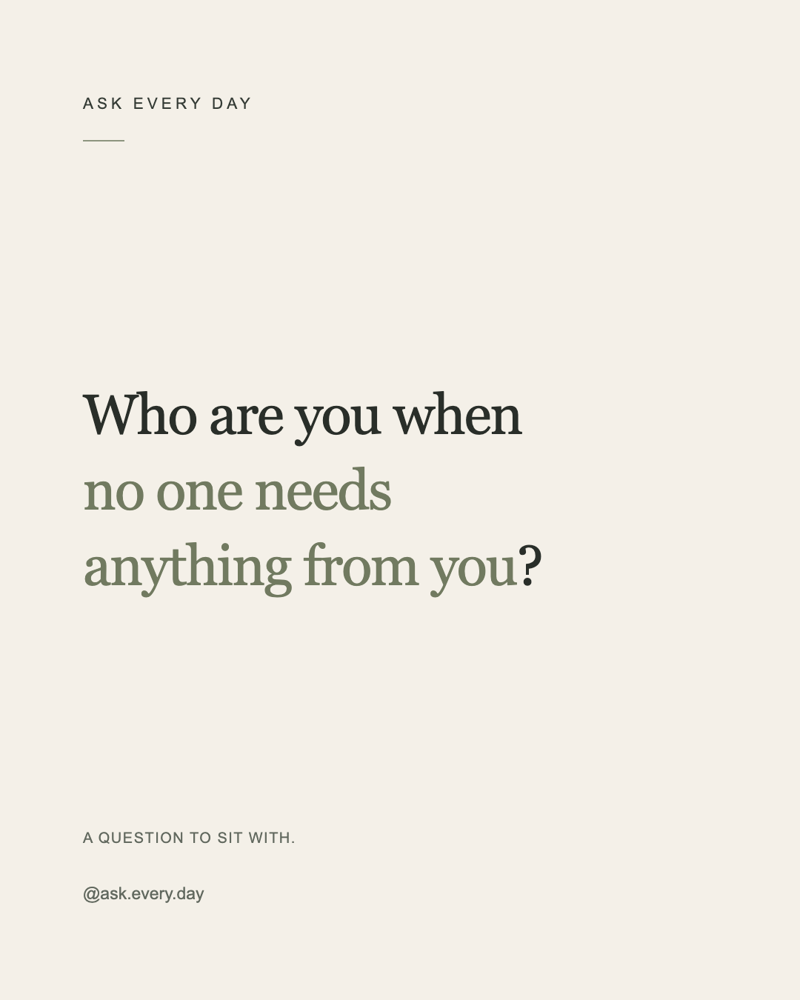

# Classic design spike — AED-009

Run `make setup` then `make prototype` from the repository root. Open
`output/classic-prototype.svg` in a browser. The command uses the project `.venv`
through uv and writes only that ignored local output; it emits one JSON log event.

The committed [SVG reference](design/classic-reference.svg) and PNG above are
intentional review artifacts for this spike. The PNG was captured at 1080×1350
in Chrome on macOS and visually checked for clipping, spacing, and hierarchy.
They are not generated production assets. Regenerate the SVG after intentional
changes to the design; refresh the visual reference after reviewing it.

## Visual decisions

- Canvas: 1080×1350, warm paper `#F4F0E8`, no texture or decorative imagery.
- Left edge: 112 px throughout; generous top/bottom whitespace keeps the question
  dominant and gives a recognizable editorial rhythm.
- Prompt: 76 px Georgia, 102 px baseline spacing, charcoal `#292E29`.
  Georgia falls back to Times New Roman and the system serif. No font files are
  distributed. System availability can change metrics; production font choice
  and deterministic rasterization remain future work.
- Highlight: muted sage `#717A60` text, retaining the serif weight and size.
  The exact phrase is highlighted across two manually chosen lines; punctuation
  remains charcoal. No boxes or highlighter-marker effects.
- Identity: small tracked sans-serif heading at y=147, a short sage rule, and
  understated footer/handle at y=1138/1214. Arial/Helvetica/system sans-serif.

## Prototype boundary

`classic_prototype.py` uses an existing `Post` domain object and supplies explicit
(prefix, highlight, suffix) triples for each line to a Jinja SVG template. It
verifies those triples reproduce the exact prompt and highlight before rendering.
The specimen's ID/category are illustrative domain metadata, not an editorial
Sheet import or an assertion about the current row with that ID.

Jinja2 is the only new direct dependency: it provides template substitution,
strict undefined values, and XML escaping. MarkupSafe is its transitive dependency.
Browser SVG display satisfies this prototype; neither CairoSVG nor Pillow is
needed. Logging uses standard-library logging with one structured JSON event for
the output write; the pure rendering function/template have no logs.

This intentionally has no automatic wrapping, text measurement, font embedding,
production renderer API, PNG exporter, batch rendering, configuration integration,
or final highlight engine. Different content requires new hand-set lines and
visual review; there is no claim that arbitrary prompts fit. AED-010 should use
this as its visual target, with robust wrapping deferred to AED-011 and final
highlight handling to AED-012.

Tests cover well-formed SVG, canvas dimensions, content/highlight preservation,
escaping with different content, and rejection of inconsistent manual layouts.
